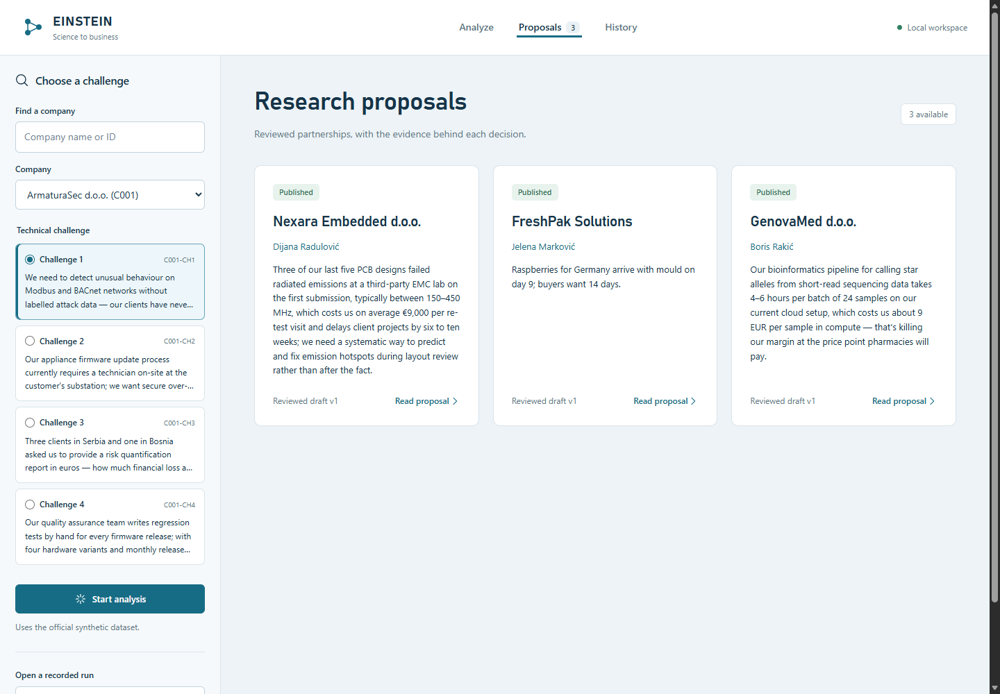
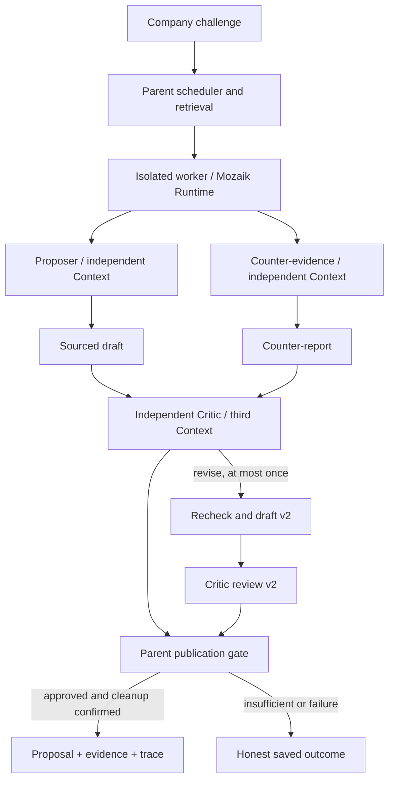

# EINSTEIN — Evidence-backed Partnerships

Turn a company challenge into a research partnership you can inspect: the source, the objections, the proposed pilot, and the review that allowed publication.

**[Open the interactive demo](https://einstein-evidence-partnerships.clearbread14.chatgpt.site)** · [Architecture](docs/architecture.md) · [Three proposals](artifacts/showcase/final/index.html) · [Demo walkthrough](docs/demo-walkthrough.md)



The public demo replays real saved model runs. It needs no API key. New analysis runs locally with your own provider key; browser-based key entry is not yet implemented.

## What to try

| Company challenge | Research partner | Proposed pilot |
| --- | --- | --- |
| Nexara Embedded — C025-CH1 | Dijana Radulović — R0637 | PCB layout screening against an EMC baseline |
| FreshPak Solutions — C036-CH1 | Jelena Marković — R0976 | Test raspberry packaging and cold-chain conditions |
| GenovaMed — C105-CH2 | Boris Rakić — R0123 | Profile genomic analysis performance and concordance |

Open a proposal, inspect a cited source, then read the independent Critic review. History also includes failures and an **Insufficient evidence** research run with two drafts and two reviews. A separate adversarial revision diagnostic is explicitly labelled and is excluded from the three formal proposals.

These are proposed pilots based on the official synthetic dataset, not completed business deployments or measured matching accuracy.

## Run locally

Tested on Windows with **Node 24.x, pnpm 11.25.0 and Git**. The live worker lifecycle uses Windows process identity checks; other operating systems are not verified for live runs.

```powershell
pnpm install --frozen-lockfile --ignore-scripts
pnpm setup:data
pnpm build:server
pnpm build:web
pnpm demo
```

Open **http://127.0.0.1:3000**. `pnpm demo` verifies the saved archive, copies it to a temporary store and disables new model requests. If port 3000 is busy, set `$env:PORT = '3002'` before starting it.

For a new analysis, stop the demo, copy `config/gateway.env.example` to `.env.local`, and configure your provider's API key, base URL and model. Then start:

```powershell
node --env-file-if-exists=.env.local dist/server/server/main.js
```

Keys remain local to the server. Never put a key in frontend source or commit `.env.local`. The tested live provider was DeepSeek with the OpenAI-compatible chat protocol. Other providers require compatibility verification. Model calls consume the configured account's quota.

`setup:data` acquires the [official synthetic dataset](https://github.com/jigjoy-ai/einstein-matchmaker-data) at commit `4fb99b3749adf0d10b5977089ff4c73f4f522240`. It pins a repository-local checkout newline policy to reproduce saved evidence bytes and does not repair an existing dirty data checkout.

## Actual multi-agent implementation



The Proposer and Counter-evidence agents execute concurrently through **Mozaik 4.2.0**, with separate Contexts and read-only source tools. The Critic receives the bound draft, counter-report and evidence snapshot and can approve, request one revision, or withhold approval. A parent-controlled gate checks source integrity, version/hash binding, approval and worker cleanup before publishing. A model's approval text alone cannot publish a proposal.

The parent allows one active Run plus three queued, two concurrent model requests globally, up to 16 admitted attempts per Run and a 180-second work deadline. Cleanup and durable writes can finish after the work deadline. Unknown process identity keeps the service on hold.

The three formal saved runs contain real client-side request overlap of approximately **4.943, 10.355 and 8.052 seconds**. See the concurrency fields in the [Showcase manifest](artifacts/showcase/final/showcase-manifest.json) and their full traces. This demonstrates overlapping requests, not a claim about provider-side scheduling.

## Complete Critic intervention traces

- **Natural research revision:** [b738ce31… events](artifacts/demo-store/b738ce31-0d8d-4eba-a01e-f4deac26a632/events.jsonl). The Critic requests changes, the system creates draft v2, then remains **insufficient**. Both reviews and the before/after are in the demo.
- **Adversarial revision diagnostic:** [0fc75288… events](artifacts/demo-store/0fc75288-4d8b-4f0a-bee1-62f19834a8fd/events.jsonl). A deliberately seeded problematic draft is revised and approved by a real model Critic. It is a diagnostic, not a formal research proposal.
- **Formal results:** each of the three [export folders](artifacts/showcase/final) contains the proposal, source evidence, complete trace and approval binding.

## EINSTEIN network and Stars

A future network adapter would accept a consented company challenge and return the structured pair, proposed pilot, evidence references and review state. Human acceptance, pilot completion and verified collaboration outcomes could become network events. Stars could reward verified contributions or completed collaboration milestones under the network's rules. This prototype does **not** implement a network API or assign a person's worth, reputation or Stars score. Retrieval orders evidence-supported candidates for a challenge; it is not a ranking of human value.

## Verification and limits

`pnpm test:offline` builds and runs the engineering suite without model requests. Windows process fixtures are explicitly labelled. The development suite recorded 1,322 passing tests; this public release adds portable historical fixtures and is verified separately in [release verification](docs/release-verification.md). High default test parallelism previously produced a native Node crash of unknown cause; bounded test-file concurrency is available in the verification instructions.

Human relevance labels are **0**, relevance metrics are **NA**, and the held-out challenges remain unopened. Three approved development cases do not establish general matching quality. Source/hash verification does not itself prove natural-language semantic support. Historical failures are retained; no synthetic success is substituted for a failed run.

This repository is a curated publication snapshot. Old frozen files required by regression tests retain their original bytes and historical path text, but tests use repository-local copies rather than reading the original machine's temporary store. Original private env files, unrelated user material and operational stores are excluded.
