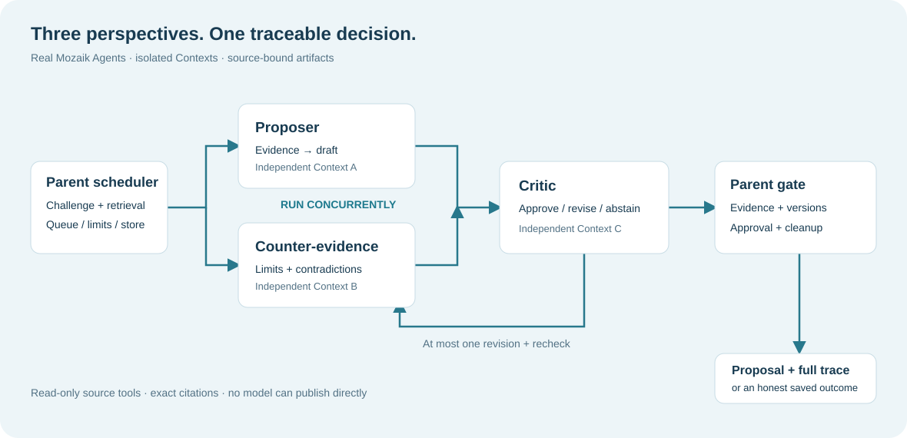

# Architecture

The React UI reads the catalog and saved history and creates a Run through the local HTTP API. The parent scheduler owns admission, cancellation, model permits, process identity and the durable RunStore. A separate worker builds a real Mozaik Runtime for each Run.

Retrieval starts from the official 1,047-researcher corpus. L0/L1/L2 retrieval retains hit provenance, identity evidence, fusion and truncation reasons, with 40 / 120 / 8 stage limits. A candidate pool is context for investigation, not a ground-truth relevance label.

Proposer and Counter-evidence start concurrently, each with an independent Context. Their tools read source records and register exact excerpts, JSON pointers and file/record/excerpt hashes. The Counter investigates limitations and contradictions. The Critic is a third Agent with an independent Context; it reviews a specific immutable draft, counter-report and source snapshot.

At most one revision is allowed. Critic findings, draft versions and later approval remain separately inspectable. The parent checks the bound hashes, source relationships, complete artifact set and cleanup result before atomically publishing a formal proposal. Failed and insufficient Runs remain available in History.

The public site uses the same React views with a build-specific read-only adapter over captured API responses. It exposes no model key and has no inference backend. Local operation retains the real worker and model path.

Key implementation entry points:

- `src/runtime/`: real SDK integration, roles, Contexts and model transport.
- `src/supervisor/`: parent scheduler, process host and permits.
- `src/storage/run-store.ts`: durable RunStore and replay recovery.
- `src/evidence/`: exact source and relationship checks.
- `src/server/`: local HTTP/SSE and validated read APIs.
- `web/src/`: proposals, sources, history, review, revision and activity views.
- `scripts/start-demo.mjs`: keyless replay archive startup.
- `scripts/build-public-demo.mjs`: static capture of the verified replay records.

To reproduce the static site, start the saved demo locally, then run `node scripts/build-public-demo.mjs`. It writes `var/submission/demo-site/dist`, including the guide, diagram, three-proposal export and captured read responses. An optional third argument supplies an explicitly reviewed source ZIP to copy; without it the guide omits the source-download link.
